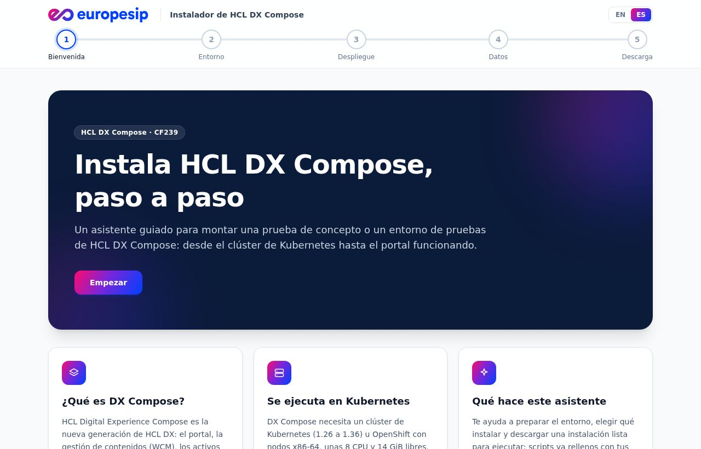
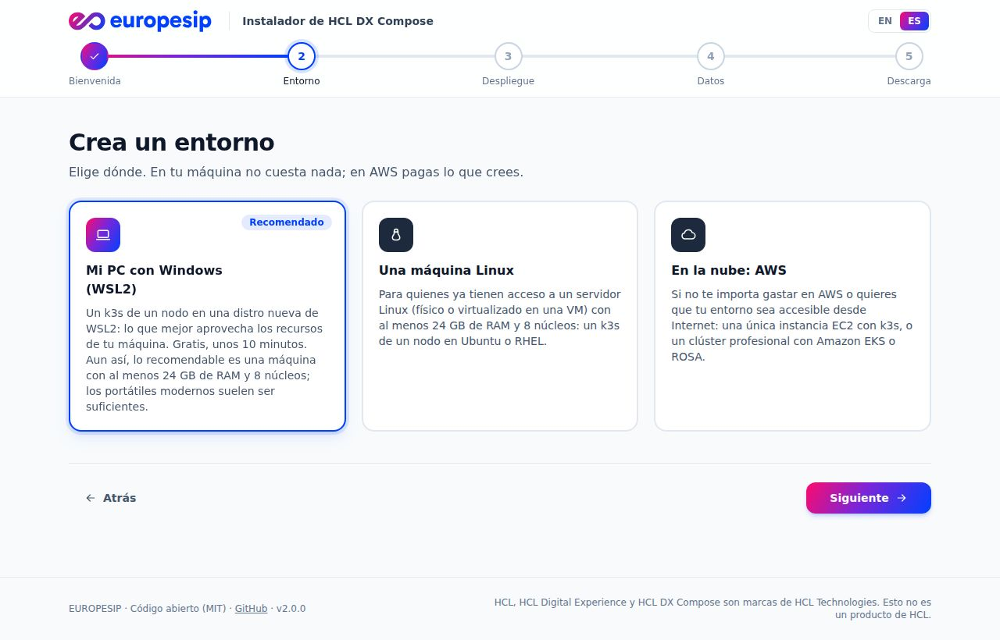
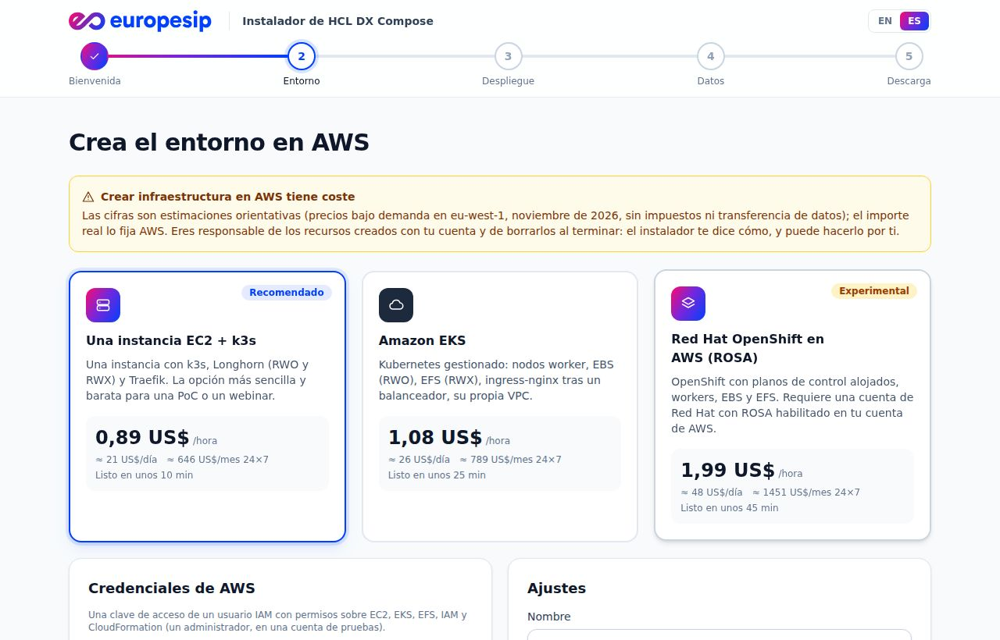
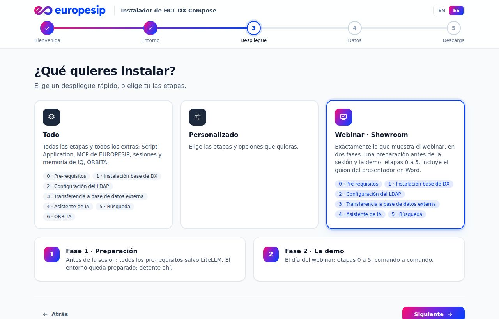
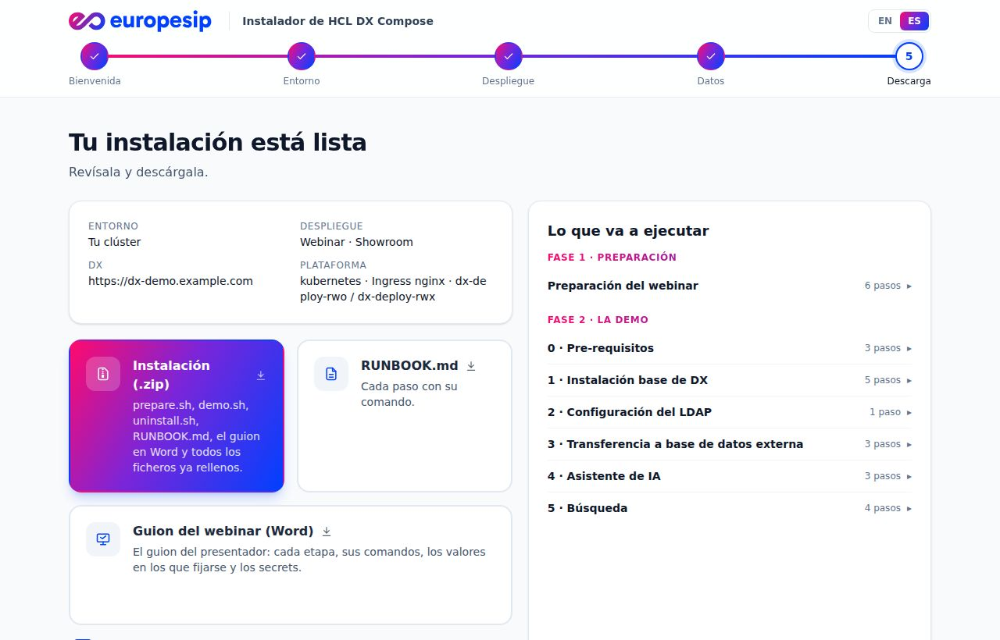

<p align="center"></p>

<h1 align="center">Instalador de HCL DX Compose</h1>

<p align="center"><b>De cero a un HCL DX Compose funcionando, paso a paso.</b><br>
Un instalador web guiado para pruebas de concepto y entornos de pruebas, de <a href="https://www.europesip.com">EUROPESIP</a>.</p>

<p align="center"><a href="README.md">English</a> · <b>Español</b> · <a href="docs/faq.es.md">Preguntas frecuentes</a> · <a href="docs/deploy.es.md">Docker y Helm</a> · <a href="docs/aws.es.md">AWS</a> · <a href="docs/how-it-works.es.md">Cómo funciona</a></p>

<p align="center"></p>

## Qué hace

- 🧭 **Te guía pantalla a pantalla**, en español o en inglés (empieza en el idioma de tu navegador).
- ☸️ **Prepara tu entorno.** Comprueba tu clúster, o te crea uno: en tu PC (WSL2), en una máquina Linux o en AWS
  (EC2 + k3s, EKS, ROSA), con estimación de coste y borrado con un clic.
- 🚀 **Instala lo que elijas:** Todo, Personalizado o la demo **Webinar · Showroom**, en etapas claras:
  0 Pre-requisitos · 1 Base DX · 2 LDAP · 3 Base de datos externa · 4 Asistente de IA · 5 Búsqueda.
- 📦 **Te entrega una instalación lista para ejecutar:** scripts rellenos con tus valores, un RUNBOOK y, para el webinar,
  el guion del presentador en Word.

<table>
<tr>
<td width="50%"><br><sub><b>Tu entorno</b>: tu PC, una máquina Linux o AWS</sub></td>
<td width="50%"><br><sub><b>AWS</b>: estimación de precio, progreso en directo, bórralo al terminar</sub></td>
</tr>
<tr>
<td width="50%"><br><sub><b>Despliegues rápidos</b>: Todo, Personalizado o Webinar</sub></td>
<td width="50%"><br><sub><b>Descarga</b>: zip, RUNBOOK y el guion del webinar</sub></td>
</tr>
</table>

## Pon en marcha el instalador

**Opción 1 · En tu máquina Windows o Mac, con Docker**

```bash
docker run --rm -p 8080:8080 ghcr.io/europesip/hcl-dx-compose-installer:2.0.0
```

Después abre http://localhost:8080.

**Opción 2 · En un clúster Kubernetes u OpenShift, con Helm**

```bash
helm upgrade --install dx-installer oci://ghcr.io/europesip/charts/hcl-dx-compose-installer --version 2.0.0 \
  -n dx-installer --create-namespace --set ingress.enabled=true --set ingress.host=installer.example.com \
  --set auth.enabled=true --set auth.username=admin --set auth.password='S3cret!'
```

> 🔒 ¿Accesible desde fuera? Deja `auth.enabled=true`. Todas las opciones del chart y de la imagen:
> **[Docker y Helm](docs/deploy.es.md)**.

## Después, instala DX Compose

Descomprime lo que descargaste y ejecútalo en una máquina con `kubectl` y `helm` apuntando a tu clúster:

```bash
unzip dx-compose-install.zip && cd dx-install && ./install.sh     # o, para el webinar: ./prepare.sh y después ./demo.sh
```

## Preguntas frecuentes

- **¿Sirve para producción?** No: pruebas de concepto, desarrollo y pruebas.
- **¿No tienes Kubernetes?** El instalador lo crea. Lo recomendado es WSL2 en tu PC: 24 GB de RAM y 8 núcleos.
- **¿AWS cuesta dinero?** Sí, desde ~0,89 USD/hora. Bórralo desde la página al terminar.
- **¿Se envían mis credenciales a algún sitio?** La instalación se genera en tu navegador. Las claves de AWS solo van a
  tu propio instalador, para la operación que le pidas.

Más preguntas: **[Preguntas frecuentes](docs/faq.es.md)**.

## Saber más

| | |
|---|---|
| [Docker y Helm](docs/deploy.es.md) | Todas las opciones para ejecutar el instalador, la autenticación, qué hacer con la descarga |
| [Entornos de AWS](docs/aws.es.md) | Qué crea cada opción de AWS, su precio, cómo borrarla, ROSA y tu cuenta de Red Hat |
| [Cómo funciona](docs/how-it-works.es.md) | Tus datos, el código, desarrollo y CI |
| [Laboratorios de HCL DX Compose](https://github.com/europesip/hcl-dx-compose-labs) | Las guías para aprender cada paso a mano |
| [ÓRBITA](https://github.com/europesip/orbita) | Una intranet para HCL DX Compose que el instalador puede añadir |

Las contribuciones son bienvenidas: abre un issue o un pull request.

## Licencia y contacto

[MIT](LICENSE) · [NOTICE](NOTICE). HCL, HCL Digital Experience y HCL DX Compose son marcas de HCL Technologies; este
proyecto no es un producto de HCL.

**EUROPESIP** · https://www.europesip.com · info@europesip.com
