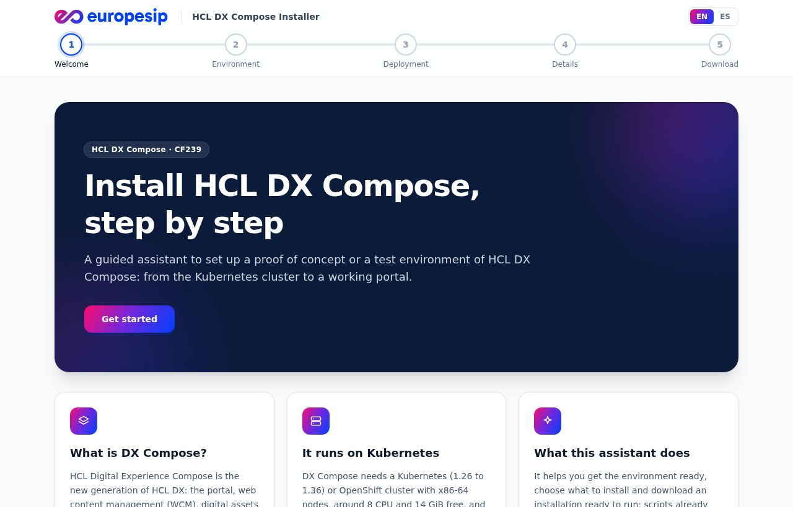
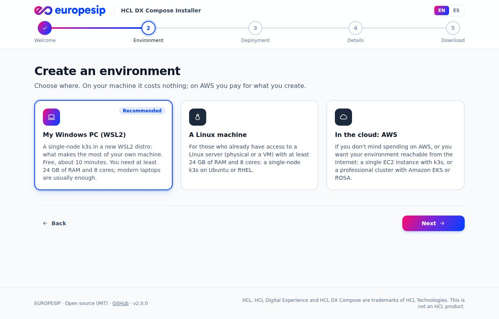
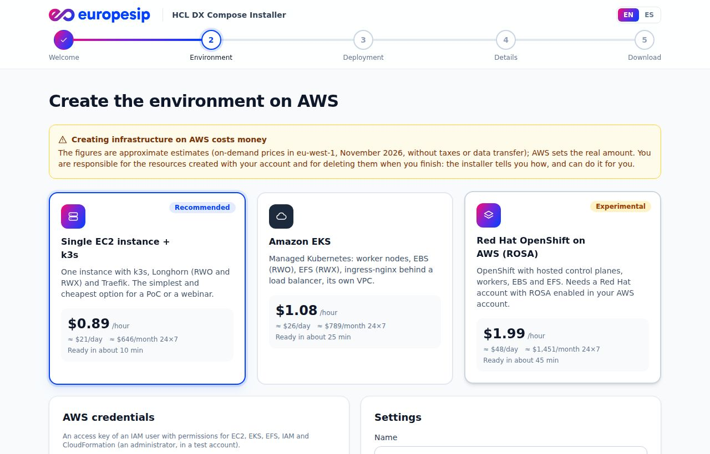
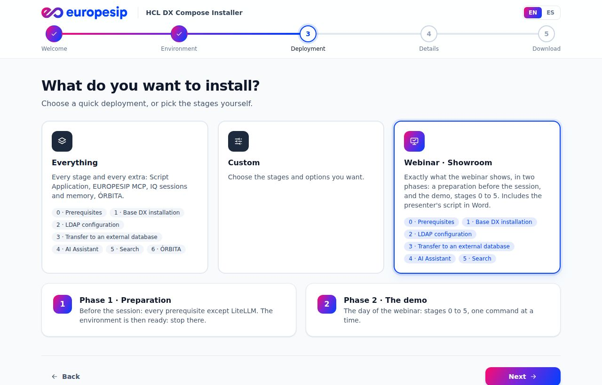
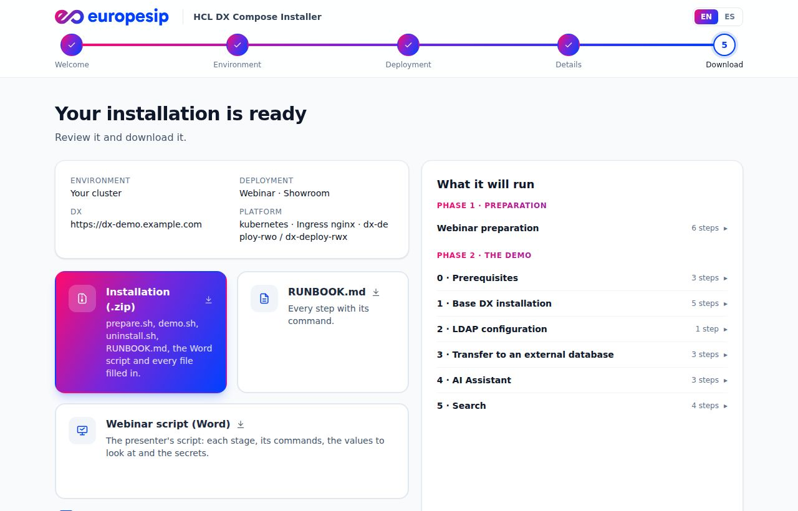

<p align="center"></p>

<h1 align="center">HCL DX Compose Installer</h1>

<p align="center"><b>From zero to a working HCL DX Compose, step by step.</b><br>
A guided web installer for proofs of concept and test environments, by <a href="https://www.europesip.com">EUROPESIP</a>.</p>

<p align="center"><b>English</b> · <a href="README.es.md">Español</a> · <a href="docs/faq.md">FAQ</a> · <a href="docs/deploy.md">Docker and Helm</a> · <a href="docs/aws.md">AWS</a> · <a href="docs/how-it-works.md">How it works</a> · <a href="CHANGELOG.md">Releases</a></p>

<p align="center"></p>

## What it does

- 🧭 **Guides you, one screen at a time**, in English or Spanish (it starts in your browser's language).
- ☸️ **Gets your environment ready.** It checks your cluster, or creates one for you: on your PC (WSL2), on a Linux
  machine, or on AWS (EC2 + k3s, EKS, ROSA) with a cost estimate and one-click deletion.
- 🚀 **Installs what you choose:** Everything, Custom, or the **Webinar · Showroom** demo, in clear stages:
  0 Prerequisites · 1 Base DX · 2 LDAP · 3 External database · 4 AI Assistant · 5 Search.
- 📦 **Hands you a ready-to-run installation:** scripts filled in with your values, a RUNBOOK and, for the webinar,
  the presenter's script in Word.

<table>
<tr>
<td width="50%"><br><sub><b>Your environment</b>: your PC, a Linux machine or AWS</sub></td>
<td width="50%"><br><sub><b>AWS</b>: price estimate, live progress, delete it when you finish</sub></td>
</tr>
<tr>
<td width="50%"><br><sub><b>Quick deployments</b>: Everything, Custom or Webinar</sub></td>
<td width="50%"><br><sub><b>Download</b>: zip, RUNBOOK and the webinar script</sub></td>
</tr>
</table>

## Get the installer running

**Option 1 · On your Windows or Mac machine, with Docker**

```bash
docker run --rm -p 8080:8080 ghcr.io/europesip/hcl-dx-compose-installer:2.4.1
```

Then open http://localhost:8080.

**Option 2 · On a Kubernetes or OpenShift cluster, with Helm**

```bash
helm upgrade --install dx-installer oci://ghcr.io/europesip/charts/hcl-dx-compose-installer --version 2.4.1 \
  -n dx-installer --create-namespace --set ingress.enabled=true --set ingress.host=installer.example.com \
  --set auth.enabled=true --set auth.username=admin --set auth.password='S3cret!'
```

> 🔒 Reachable from outside? Keep `auth.enabled=true`. Every option of the chart and of the image:
> **[Docker and Helm](docs/deploy.md)**.

## Then, install DX Compose

Unzip what you downloaded and run it on a machine with `kubectl` and `helm` pointing to your cluster:

```bash
unzip dx-compose-install.zip && cd dx-install && ./install.sh     # or, for the webinar: ./prepare.sh, then ./demo.sh
```

## 🔒 Security

Typing credentials for the cloud or other systems (HCL registry, OpenRouter, Red Hat, AWS) is always a risk, all the
more in a third-party tool. We know, and that is why:

- **The code is public and free** (MIT): anyone can check that credentials are not sent or stored anywhere.
- **The installation is generated in your browser.** Registry, OpenRouter and password values never leave it; they go
  into the scripts of your zip.
- **AWS and Red Hat credentials go only to your own installer**, for the operation you ask for: never to disk or logs.
- **You can limit its outbound access:** without the AWS functions, the pod (NetworkPolicy) or container connects to
  nothing at all.
- **Use the original image** (`ghcr.io/europesip/hcl-dx-compose-installer`) or build it from the source.
- **Good practice:** use ephemeral credentials, or rotate them when the installation is done.

All the details: **[Security of the installer](docs/security.md)**.

## FAQ

- **Is it for production?** No: proofs of concept, development and tests.
- **No Kubernetes?** The installer creates it. WSL2 on your PC is the recommended option: 24 GB of RAM and 8 cores.
- **Does AWS cost money?** Yes, from ~0.89 USD/hour. Delete it from the page when you finish.
- **Are my credentials sent anywhere?** No: see [Security](docs/security.md).

More questions: **[FAQ](docs/faq.md)**.

## Learn more

| | |
|---|---|
| [Docker and Helm](docs/deploy.md) | Every option to run the installer, authentication, what to do with the download |
| [AWS environments](docs/aws.md) | What each AWS option creates, its price, how to delete it, ROSA and your Red Hat account |
| [Advanced CI/CD: OpenBao](docs/openbao.md) | OpenBao secrets manager, Argo CD and the Script Application operator: unsealing, and why a DX password change needs a helm upgrade |
| [Third-party software](docs/third-party.md) | OpenLDAP, PostgreSQL, LiteLLM, MCP, OpenBao, Argo CD and Keycloak: the peculiarities and tricks found in the lab |
| [Security](docs/security.md) | Where each credential goes, limited outbound access, the original image, good practice |
| [How it works](docs/how-it-works.md) | Your data, the code, development and CI |
| [HCL DX Compose labs](https://github.com/europesip/hcl-dx-compose-labs) | The guides to learn every step by hand |
| [ÓRBITA](https://github.com/europesip/orbita) | An intranet for HCL DX Compose that the installer can add |

Contributions are welcome: open an issue or a pull request.

## Licence and contact

[MIT](LICENSE) · [NOTICE](NOTICE). HCL, HCL Digital Experience and HCL DX Compose are trademarks of HCL Technologies;
this project is not an HCL product.

**EUROPESIP** · https://www.europesip.com · info@europesip.com
