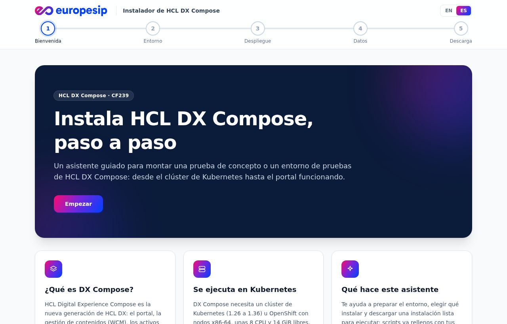

# DX Installer Wizard, de EuropeSIP

[English](index.md) · **Español**

Un asistente web, de EuropeSIP, que convierte unas pocas respuestas en una **instalación de HCL DX Compose lista para
ejecutar**: scripts rellenos con tus valores, los custom values de cada chart de Helm, los secretos, un `RUNBOOK.md`
paso a paso y, para el webinar, el guion del presentador. Es código abierto (MIT) y no es un producto de HCL.



## Para quién es

- **Partners, consultores y equipos de plataforma** que necesitan un entorno de HCL DX Compose para una demo, una
  prueba de concepto, formación, desarrollo o como punto de partida de su propia instalación.
- **Presentadores de webinars y showrooms**: el despliegue *Webinar · Showroom* reproduce el webinar de EuropeSIP en
  dos fases (`prepare.sh` el día anterior, `demo.sh` en directo).
- **Automatización**: el [modo headless](headless.es.md) genera la misma carpeta desde Node (una plantilla de
  Backstage, un job de CI).

No es una herramienta de dimensionamiento para producción: una plataforma con mucha carga necesita ajustes (JVM, pools,
réplicas, alta disponibilidad, bastionado) que quedan fuera de su alcance.

## Cómo funciona

```
 1. Respuestas             2. Carpeta generada                    3. Instalación (una persona, helm de verdad)
 ─────────────             ───────────────────                    ────────────────────────────────────────────
 asistente web ──o──►  dx-install/                         ──►   ./install.sh  (o prepare.sh + demo.sh)
 headless (JSON)           install.sh · RUNBOOK.md                kubectl + helm contra tu clúster
                           values · secretos · BUILD-INFO.txt     etapas 0-5 + extras, comprobación tras cada paso
```

1. **Respuestas.** Dónde instalar (tu clúster, un PC con WSL2, una máquina Linux, AWS EC2/EKS/ROSA), qué instalar
   (*Todo*, *Personalizado* o *Webinar*), los nombres y las credenciales.
2. **Carpeta generada.** Todo se genera **en tu navegador** (o en tu proceso de Node, en headless): ninguna credencial
   se envía a ningún servidor. La carpeta es autosuficiente: cada fichero ya está relleno.
3. **Instalación.** Una persona ejecuta `install.sh` con `kubectl` y **`helm` de verdad**, siguiendo el RUNBOOK. Cada
   paso se puede reanudar (`--from`), comprobar (`--verify`) y recoger sus datos para el soporte de HCL (`--collect`).

> **Día 0 y día 1.** HCL DX se instala **de forma imperativa, con Helm**, nunca con Argo CD ni otro controlador
> GitOps: sus charts guardan estado en la release de Helm (hooks, actualizaciones, transferencia de la base de datos).
> Lo que corre *sobre* el portal después (Script Applications, temas, páginas) sí se puede gestionar con GitOps
> mediante el operador de Script Applications de EuropeSIP, y se ve en Backstage con el plugin de HCL DX.

### Etapas y extras

| Etapa | Qué instala |
|---|---|
| 0 · Requisitos previos | Comprobaciones, namespaces, CAs corporativas, OpenLDAP, PostgreSQL (CloudNativePG) |
| 1 · DX base | HCL DX Compose (Web Engine, DAM, Ring API...), Ingress y TLS |
| 2 · LDAP | DX conectado a OpenLDAP o Active Directory, acceso por correo, administradores |
| 3 · Base de datos externa | Web Engine transferido de Derby a PostgreSQL (u Oracle) |
| 4 · Asistente de IA | HCL DX IQ con LiteLLM (OpenRouter, AWS Bedrock o Anthropic), servidor MCP y RAG opcionales |
| 5 · Búsqueda | Search V2 (OpenSearch) |
| Extras | Script Application Hello DX, ÓRBITA, Keycloak (SSO), OpenBao + External Secrets, Argo CD, operador de Script Applications |

### Las piezas

| Pieza | Qué es |
|---|---|
| Página web | React + Tailwind CSS, inglés y español; genera la carpeta en el navegador |
| Servidor | Node: sirve la página y ejecuta los scripts de AWS (crear/borrar) con la salida en directo (solo si se usa AWS) |
| Motor | `src/engine/` + `src/bundle.js`: ficheros, pasos, `install.sh`, RUNBOOK |
| Headless | `src/headless.js` + `bin/dx-installer.mjs`: el motor sin la página ([Modo headless](headless.es.md)) |
| Empaquetado | Imagen `ghcr.io/europesip/hcl-dx-compose-installer` y chart de Helm `oci://ghcr.io/europesip/charts/hcl-dx-compose-installer` |

## Por dónde empezar

- [Requisitos](requirements.es.md): qué necesitas para ejecutar el instalador y la instalación que genera.
- [Docker y Helm](deploy.es.md): todas las formas de ejecutar el instalador.
- [Modo headless](headless.es.md): el motor como librería de Node y CLI.
- [Seguridad](security.es.md) · [Preguntas frecuentes](faq.es.md) · [Errores frecuentes](troubleshooting.es.md).
- Código, versiones y hoja de ruta: [GitHub](https://github.com/europesip/hcl-dx-compose-installer) ·
  [Versiones](https://github.com/europesip/hcl-dx-compose-installer/releases) ·
  [Hoja de ruta](https://github.com/orgs/europesip/projects/1).

Licencia: [MIT](https://github.com/europesip/hcl-dx-compose-installer/blob/main/LICENSE). Servicios profesionales y
contacto: [EuropeSIP](https://www.europesip.com/es/europesip/contacto).
