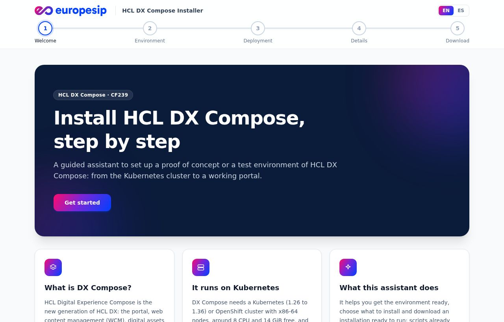

# DX Installer Wizard, by EuropeSIP

**English** · [Español](index.es.md)

A web wizard, by EuropeSIP, that turns a few answers into a **ready-to-run installation of HCL DX Compose**: scripts
filled in with your values, the custom values of every Helm chart, the secrets, a step-by-step `RUNBOOK.md` and, for
the webinar, the presenter's script. It is open source (MIT) and it is not an HCL product.



## Who it is for

- **Partners, consultants and platform teams** who need an HCL DX Compose environment for a demo, a proof of concept,
  training, development, or as the starting point of their own installation.
- **Webinar and showroom presenters**: the *Webinar · Showroom* preset reproduces the EuropeSIP webinar in two phases
  (`prepare.sh` the day before, `demo.sh` live).
- **Automation**: the [headless mode](headless.md) generates the same folder from Node (a Backstage template, a CI job).

It is not a production sizing tool: a platform with high load needs tuning (JVM, pools, replicas, HA, hardening) that is
outside its scope.

## How it works

```
 1. Answers                2. Generated folder                    3. Installation (a person, real helm)
 ───────────               ───────────────────                    ─────────────────────────────────────
 web wizard  ──or──►  dx-install/                          ──►   ./install.sh  (or prepare.sh + demo.sh)
 headless (JSON)          install.sh · RUNBOOK.md                 kubectl + helm against your cluster
                          values · secrets · BUILD-INFO.txt       stages 0-5 + extras, checks after each step
```

1. **Answers.** Where to install (your cluster, a PC with WSL2, a Linux machine, AWS EC2/EKS/ROSA), what to install
   (*Everything*, *Custom* or *Webinar*), the names and the credentials.
2. **Generated folder.** Everything is generated **in your browser** (or in your Node process, headless): no
   credential is sent to any server. The folder is self-contained: every file is already filled in.
3. **Installation.** A person runs `install.sh` with `kubectl` and **real `helm`**, following the RUNBOOK. Each step
   can be resumed (`--from`), checked (`--verify`) and its data collected for HCL Support (`--collect`).

> **Day 0 vs day 1.** HCL DX itself is installed **imperatively, with Helm**, never by Argo CD or any GitOps
> controller: its charts keep state in the Helm release (hooks, upgrades, database transfer). What runs *on* the
> portal afterwards (Script Applications, themes, pages) can be managed with GitOps through the EuropeSIP Script
> Application operator, and is visible in Backstage with the HCL DX plugin.

### Stages and extras

| Stage | What it installs |
|---|---|
| 0 · Prerequisites | Checks, namespaces, corporate CAs, OpenLDAP, PostgreSQL (CloudNativePG) |
| 1 · Base DX | HCL DX Compose (Web Engine, DAM, Ring API...), Ingress and TLS |
| 2 · LDAP | DX connected to OpenLDAP or Active Directory, sign-in by e-mail, administrators |
| 3 · External database | Web Engine transferred from Derby to PostgreSQL (or Oracle) |
| 4 · AI Assistant | HCL DX IQ with LiteLLM (OpenRouter, AWS Bedrock or Anthropic), optional MCP server and RAG |
| 5 · Search | Search V2 (OpenSearch) |
| Extras | Hello DX Script Application, ÓRBITA, Keycloak (SSO), OpenBao + External Secrets, Argo CD, DX Delivery Operator |

### The pieces

| Piece | What it is |
|---|---|
| Web page | React + Tailwind CSS, English and Spanish; generates the folder in the browser |
| Server | Node: serves the page and runs the AWS create/delete scripts with live output (only when AWS is used) |
| Engine | `src/engine/` + `src/bundle.js`: files, steps, `install.sh`, RUNBOOK |
| Headless | `src/headless.js` + `bin/dx-installer.mjs`: the engine without the page ([Headless mode](headless.md)) |
| Packaging | Image `ghcr.io/europesip/hcl-dx-compose-installer` and Helm chart `oci://ghcr.io/europesip/charts/hcl-dx-compose-installer` |

## Start here

- [Requirements](requirements.md): what you need to run the installer and the installation it generates.
- [Docker and Helm](deploy.md): every way to run the installer.
- [Headless mode](headless.md): the engine as a Node library and a CLI.
- [Security](security.md) · [FAQ](faq.md) · [Frequent errors](troubleshooting.md).
- Source, releases and roadmap: [GitHub](https://github.com/europesip/hcl-dx-compose-installer) ·
  [Releases](https://github.com/europesip/hcl-dx-compose-installer/releases) ·
  [Roadmap](https://github.com/orgs/europesip/projects/1).

Licence: [MIT](https://github.com/europesip/hcl-dx-compose-installer/blob/main/LICENSE). Professional services and
contact: [EuropeSIP](https://www.europesip.com/es/europesip/contacto).
